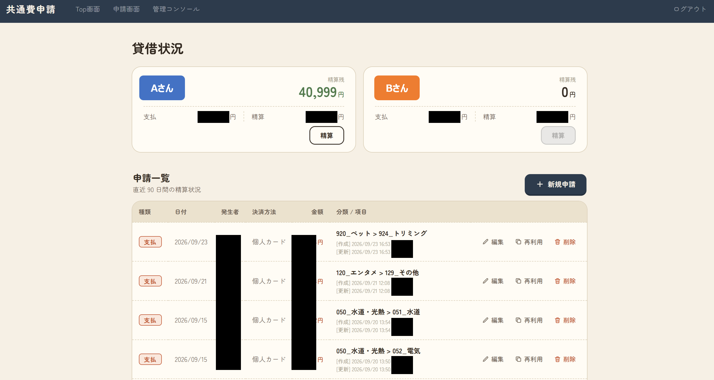
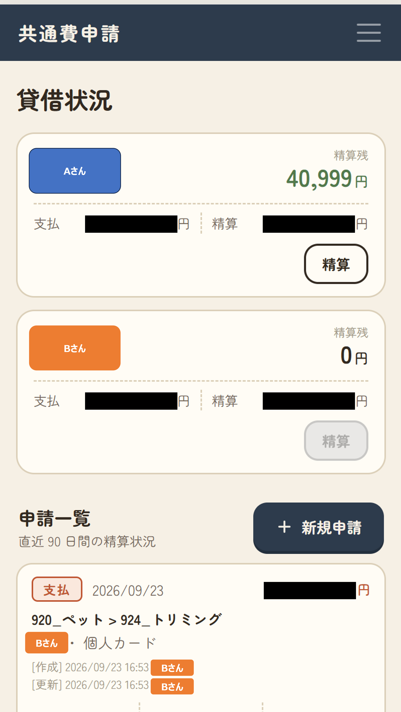
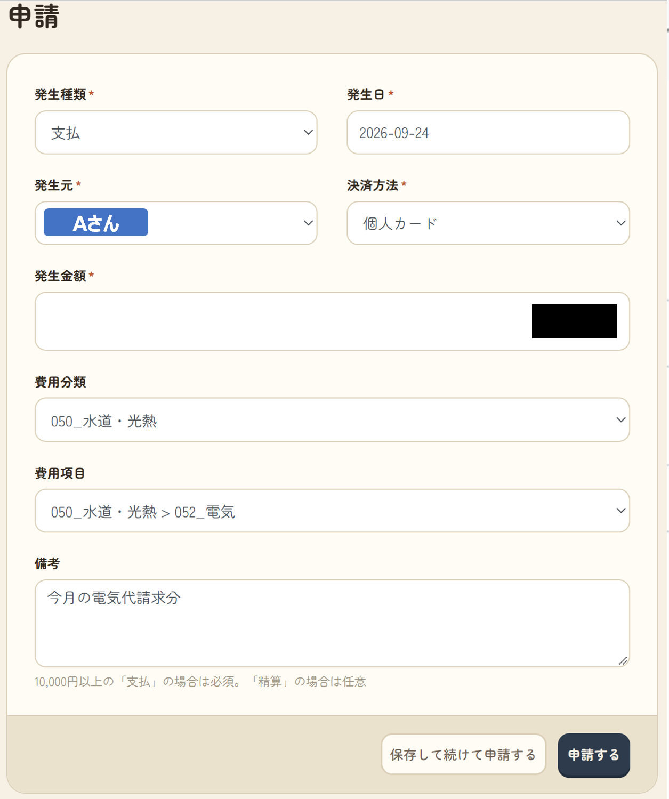
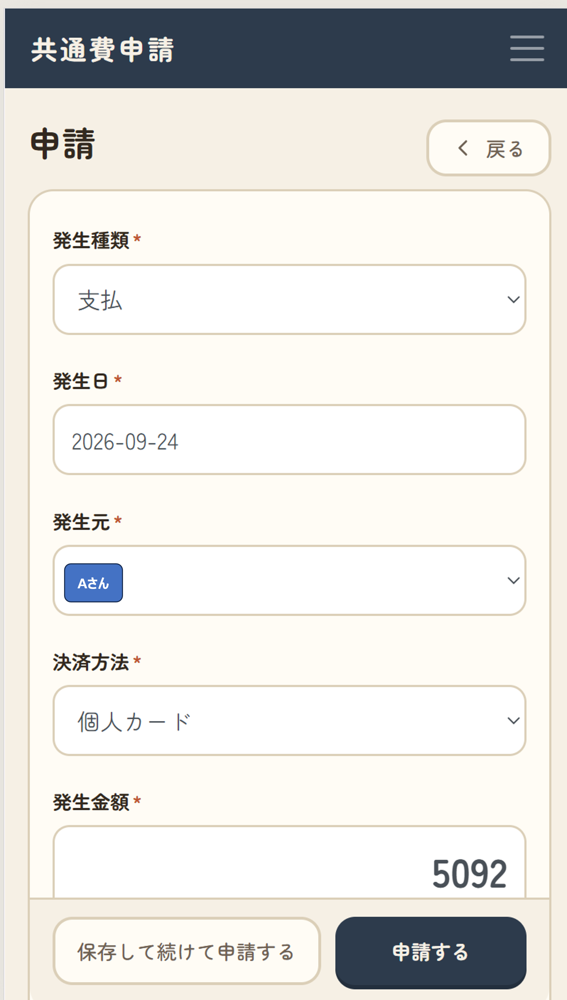
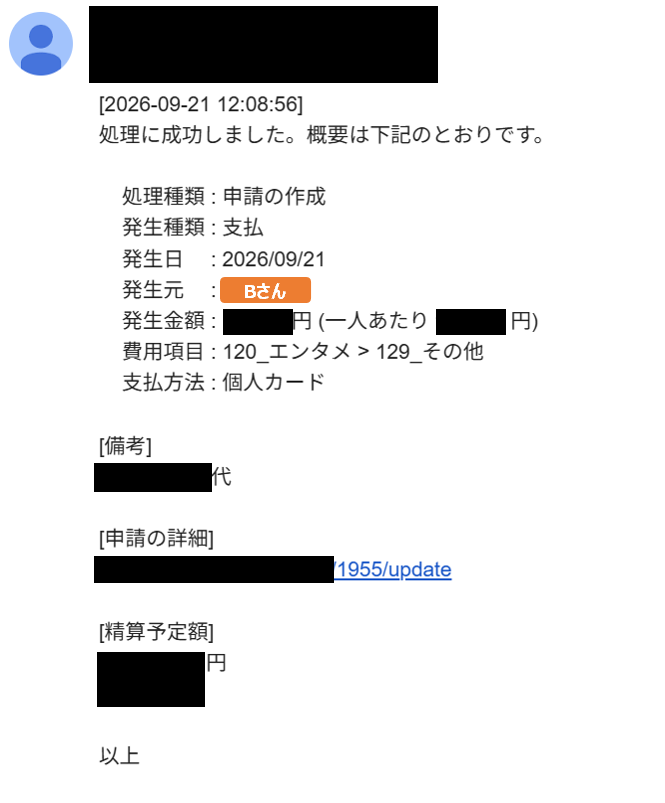
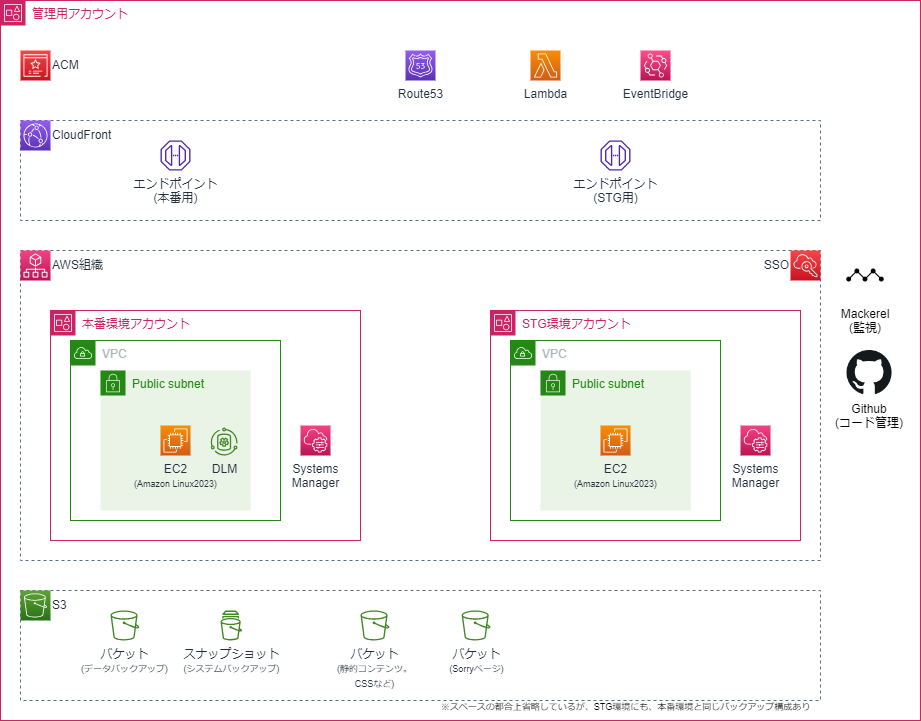

# 共通費申請アプリ — プロジェクト紹介

> [!Note]
> 本資料の土台は [Claude Code](https://claude.ai/code) を使用して作成しています。

---

## 1. プロジェクト概要

### アプリの目的

2人の家族間で共通生活費（食費・光熱費など）を管理・精算するWebアプリケーション。

| 項目 | 内容 |
|---|---|
| 本番 URL | xxx |
| STG URL | xxx |
| 開発 URL | xxx |
| 開発体制 | 個人開発（1名） |

### アプリの主な機能

- 共通費の申請・一覧表示・精算
- 申請時にメール通知
- レスポンシブデザイン（PC・スマートフォン対応）
- 申請の再利用機能

### 技術スタック（アプリ層）

| カテゴリ | 技術 |
|---|---|
| バックエンド | Python / Django |
| フロントエンド | Bootstrap |
| データベース | SQLite |
| アプリサーバ | uWSGI |
| Webサーバ | Nginx |
| OS | Amazon Linux (EC2) |
| 監視 | Mackerel（無料版）、外形監視（後述） |

### 画面イメージ

#### トップ画面

<p align="center"></p>

<details>
<summary>参考：スマートフォン版</summary>
<p align="center"></p>
</details>

#### 申請画面

<p align="center"></p>

<details>
<summary>参考：スマートフォン版</summary>
<p align="center"></p>
</details>

#### 通知メール

<p align="center"></p>

#### メンテナンス画面

<p align="center"></p>

---

## 2. AWS アーキテクチャ

### 構成図



### 設計コンセプト

> **「とにかく安く、でも本格的に」**
> コスト目標: **1,000円/月以下**

マネージドサービスを最大限活用し、運用負荷を最小化しながらコスト効率を追求した構成。

---

### 2-1. マルチアカウント構成

AWS Organizations とAWS IAM Identity Center（旧AWS SSO）を用いてアカウントを階層管理。開発環境（ローカル）を除き、本アプリに関係するアカウントは「管理用アカウント」「共通基盤アカウント」「本番環境アカウント」「STG環境アカウント」の4つ。

```
管理用アカウント (ネットワーク・DNS層)
├── Amazon Route 53
├── Amazon CloudFront (本番用/STG用エンドポイント) + AWS ACM
├── Amazon S3 (データバックアップ・静的ファイル・Sorryコンテンツ)
└── AWS Lambda (Route53 Aレコード自動更新)

AWS組織 (AWS Organizations + AWS IAM Identity Center)
├── 共通基盤アカウント
│   ├── 外形監視 (Lambda / EventBridge Scheduler / CloudWatch / SNS)
│   └── GitHub Actions 用 OIDC プロバイダ・IAM ロール
│
├── 本番環境アカウント (アプリ層)
│   ├── Amazon EC2 (Djangoアプリ)
│   ├── AWS Systems Manager (自動化)
│   ├── Amazon EventBridge (スケジュール・EC2起動検知)
│   └── Amazon DLM (週次スナップショット)
│
└── STG環境アカウント (アプリ層) ※本番と同構成（バックアップ含む）
```

- 共通基盤アカウントのリソースは、複数システムで共有する共通インフラリポジトリ（別リポジトリ）で CloudFormation + GitHub Actions により管理している

**マルチアカウントの利点**
- 本番／STGの障害影響を分離
- IAMポリシーをアカウント単位で独立管理
- AWS Organizations + IAM Identity Center による一元的なアカウント・アクセス管理

---

### 2-2. 利用 AWS サービス一覧

#### 管理用アカウント

※ 将来的に、管理用アカウントのリソースは共通基盤アカウントに移す予定（管理用アカウントではワークロードを実行させない）。

| サービス | 用途 | Well-Architectedの観点 |
|---|---|---|
| **AWS Organizations** | 各アカウントの一元管理 | 運用上の優位性 |
| **AWS IAM Identity Center** | アカウント横断のシングルサインオン・アクセス管理 | セキュリティ・運用上の優位性 |
| **Amazon Route 53** | DNSおよびドメイン管理 | 信頼性 |
| **Amazon CloudFront** | SSLアクセラレータ、静的ファイルキャッシュ、EC2/S3へのルーティング（本番用・STG用エンドポイントを分離） | パフォーマンス効率・セキュリティ |
| **AWS ACM** | SSL/TLS証明書の管理（自動更新） | セキュリティ・運用上の優位性 |
| **Amazon S3** | 静的ファイル・Sorryコンテンツ配信（本番・STGで専用バケットを分離）、データバックアップ保管 | 信頼性・コスト最適化 |
| **AWS Lambda** | EC2起動時のRoute53 Aレコード自動更新（各アカウントのEventBridgeルールから直接呼び出される） | 運用上の優位性・コスト最適化 |

#### 共通基盤アカウント

| サービス | 用途 | Well-Architectedの観点 |
|---|---|---|
| **AWS Lambda / Amazon EventBridge Scheduler / Amazon CloudWatch / Amazon SNS** | 外形監視（[2-4](#2-4-外形監視共通基盤の利用) 参照） | 信頼性・運用上の優位性 |
| **AWS IAM (OIDC プロバイダ)** | GitHub Actions からのデプロイ認証（長期のアクセスキーを使わない） | セキュリティ |
| **AWS CloudFormation** | 共通基盤のリソースを IaC で管理（GitHub Actions からデプロイ） | 運用上の優位性 |

#### 各アカウント（本番・STG）

| サービス | 用途 | Well-Architectedの観点 |
|---|---|---|
| **Amazon EC2** | Djangoアプリのホスティング。年間 RI で購入 | パフォーマンス効率・コスト最適化 |
| **AWS Systems Manager** | EC2の定期起動・停止（Automation）、データバックアップ（Run Command） | 運用上の優位性・コスト最適化 |
| **AWS Systems Manager Parameter Store** | 機密情報・設定値のコード外部管理 | セキュリティ・運用上の優位性 |
| **Amazon EventBridge** | EC2の定期起動・停止スケジュール、EC2起動を検知して管理用アカウントのLambdaを直接呼び出す | 運用上の優位性 |
| **Amazon DLM** | EBSの週次スナップショット自動取得 | 信頼性 |
| **S3 VPCエンドポイント** | EC2からS3へのプライベート通信 | セキュリティ |

---

### 2-3. CloudFront ⇔ EC2 のリクエストフロー

```
クライアント (PC/スマートフォン)
  → Amazon CloudFront (本番用/STG用エンドポイント、AWS ACM による HTTPS)
    → Amazon EC2: Nginx (CloudFront 経由であることを検証)
      → Amazon EC2: uWSGI / Django
```

- CloudFront のキャッシュポリシーで、オリジンへ転送するヘッダー等を必要最小限に絞る設計
- 動的コンテンツを考慮し、オリジン（EC2）向けのキャッシュは実質無効化
- 本番・STG で CloudFront のエンドポイントとオリジン（EC2）を分離し、環境間の影響を排除
- セキュリティグループは CloudFront の origin-facing prefix list からの通信のみ許可
- prefix list による制限は特定のディストリビューション専用ではないため、多層防御として Origin Custom Header を EC2 上の Nginx で検証し、CloudFront を経由しないアクセスを遮断

---

### 2-4. 外形監視（共通基盤の利用）

本アプリ専用ではなく、複数システムで共有する共通インフラ（別リポジトリで管理）の仕組みを利用して死活監視を行っている。

| 項目 | 内容 | Well-Architectedの観点 |
|---|---|---|
| 監視方式 | AWS Lambda が対象 URL へ定期的に HTTP リクエストを送信 | 信頼性 |
| スケジューリング | Amazon EventBridge Scheduler | 運用上の優位性 |
| メトリクス | Amazon CloudWatch カスタムメトリクス | 信頼性 |
| アラート通知 | CloudWatch Alarm → Amazon SNS (raw) → AWS Lambda で日本語の本文に整形 → Amazon SNS (通知用) 経由でメール通知 | 運用上の優位性・信頼性 |
| アラームミュート | EC2 の定期停止時間帯に合わせて自動ミュート（CloudWatch Alarm Mute Rule） | コスト最適化・運用上の優位性 |
| IaC・デプロイ | AWS CloudFormation + GitHub Actions（AWS 認証は OIDC） | 運用上の優位性・セキュリティ |

- Alarm Mute Rule は `AlarmActions`/`OKActions` の実行を抑制するため、ミュート期間中は raw 用 SNS への通知自体が発生せず、整形用 Lambda も起動されない

---

## 3. 工夫したポイント（AWS アーキテクチャ）

### 3-1. EC2 定期起動・停止によるコスト削減

サービス提供時間を限定し、深夜帯はEC2を停止。

```
EventBridge (cron) → SSM Automation → EC2 起動/停止
```

**コスト効果**: EC2 稼働時間を削減。パブリック IPv4 アドレス課金も停止中は発生しない。

……のだったのが、途中から年間 RI 購入に切り替えたため、特に止める必要はなくなった (ただし、パブリック IPv4 の課金は停止するので、全く無駄なわけではない)。ただし、本番運用のイメージ & 安定稼働のために、定期停止・定期起動の運用は残している。

---

### 3-2. Lambda による動的 DNS 自動更新

EC2 停止中はパブリック IP が解放されるため、起動時に IP が変わる。
**Elastic IP を使わず**、Lambda + EventBridge で Route53 を自動更新する設計を採用。

```
EC2 起動
  → EventBridge ルール (各アカウント。EC2 State Change 検知)
    → Lambda (管理用アカウント。クロスアカウントターゲットとして直接呼び出し)
      → STS AssumeRole で各アカウントの EC2 情報を取得
        → Route53 Aレコード UPSERT
```

- 各アカウントの EventBridge ルールから、管理用アカウントの Lambda を直接呼び出す（管理用アカウントのイベントバスは経由しない）
- 呼び出し側は EventBridge の実行ロール、呼び出される側は Lambda のリソースベースポリシーで許可する

**Elastic IP 不使用の理由**
- 停止中の Elastic IP にも課金が発生（2024年以降は稼働中も課金）
- Lambda + Route53 による動的更新で IP 管理コストをゼロに

**EC2 タグ連携**: EC2 のタグに FQDN を設定するだけで、Lambda が自動的に対象ホスト名を解決する柔軟な設計。

---

### 3-3. クロスアカウントアクセス（STS AssumeRole）

S3 バックアップ・Route53 更新いずれも、アカウント間のリソースアクセスに **STS AssumeRole** を活用。

```
本番/STG環境アカウント (EC2)
  → sts:AssumeRole
    → 管理用アカウント (S3)

管理用アカウント (Lambda)
  → sts:AssumeRole
    → 本番/STG環境アカウント (EC2 情報の参照)
```

- EC2 インスタンスロール → AssumeRole → S3 クロスアカウントアクセス（データバックアップ・静的ファイルのアップロード）
- Lambda 実行ロール → AssumeRole → 各アカウントの EC2 情報を参照（読み取り専用）し、管理用アカウントの Route53 を更新
- 最小権限の原則に従い、必要なアクションのみを許可するポリシーを設計

---

### 3-4. 多層バックアップ戦略

| バックアップ種別 | 手段 | 頻度 | 保管先 |
|---|---|---|---|
| **データバックアップ** (SQLiteファイル) | EventBridge → SSM Run Command → S3 cp | 毎日深夜 | Amazon S3（管理用アカウント） |
| **システムバックアップ** (EBSスナップショット) | Amazon DLM | 毎週深夜 | EBSスナップショット（各アカウント） |

- データ（SQLite）は軽量なためS3への日次コピーが容易
- S3 のバージョニングとライフサイクルルールで保存期間を管理
- EBSスナップショットにより、OSレベルの障害にも対応
- RPO（目標復旧時点）: データ最大24時間 / システム最大7日間

---

### 3-5. CloudFront による統合エントリーポイント

```
クライアント
  → Amazon CloudFront (+ AWS ACM による HTTPS)
    ├── /static/* → Amazon S3 (静的ファイル)
    └── /* → Amazon EC2 (Djangoアプリ)
               └── 500 応答時 → Amazon S3 (Sorry ページ)
```

- **SSL/TLS**: ACM 証明書を CloudFront にアタッチ（証明書の自動更新）
- **オリジンの抽象化**: EC2 の IP が変わっても、ユーザーは CloudFront のドメインのみ意識すれば良い
- **コスト削減**: 静的ファイルを S3 からキャッシュ配信することで EC2 の負荷を低減
- **静的ファイルのキャッシュ**: 静的ファイルは CloudFront でキャッシュし、更新時は invalidation で反映する
- **S3 アクセス制御**: OAC を使い、バケットポリシーで対応する環境の CloudFront のみ許可。パブリックアクセスブロックは有効
- **環境分離**: 本番・STG で専用の S3 バケットを持ち、一方へのアップロードがもう一方の配信に影響しない
- **フェイルオーバー**: EC2 停止中（メンテナンス時間帯）はオリジンから 500 応答が返るため、S3 の Sorry ページに切り替えて表示

---

## 4. AWS Well-Architected フレームワークの観点

| 柱 | 取り組み |
|---|---|
| **運用上の優位性** | EventBridge + SSM による EC2 の自動起動・停止、Lambda による DNS 自動更新、DLM によるスナップショット自動取得、Parameter Store による設定値の一元管理、IAM Identity Center によるアクセス管理の一元化 |
| **セキュリティ** | CloudFront + ACM による HTTPS 強制、セキュリティグループ（CloudFront origin-facing prefix list）と Origin Custom Header の検証による CloudFront 経由以外のアクセス遮断、OAC による S3 へのアクセス制御、S3 VPC エンドポイントによるプライベート通信、STS AssumeRole による最小権限のクロスアカウントアクセス、Parameter Store による機密情報のコード外部管理、ログイン試行回数の制限、GitHub Actions の OIDC 認証（長期のアクセスキー不使用）、CLI アクセスの送信元 IP 制限 |
| **信頼性** | マルチアカウント構成による環境分離、多層バックアップ（S3 日次 + DLM 週次）、CloudFront による高可用な配信、外形監視（Lambda + CloudWatch + SNS）による異常検知 |
| **パフォーマンス効率** | CloudFront による静的ファイルキャッシュ、サービス要件に合わせた EC2 インスタンスタイプ選定 |
| **コスト最適化** | Elastic IP 不使用（Lambda + Route53 で代替）、S3 + CloudFront による静的配信でEC2負荷低減、マネージドサービス活用による運用コスト削減、外形監視アラームの定期停止時間帯自動ミュート |
| **サステナビリティ** | EC2 夜間停止によるコンピューティングリソースの節約 |

---

## 5. コスト構造（目標: 1,000円/月以下）

為替によりけりだが、おそらく 1,000円/月は切っていると思う。

| サービス | 備考 |
|---|---|
| Amazon EC2 | 軽量インスタンスタイプの利用、年間 RI の利用 |
| Amazon VPC | パブリック IPv4 の利用料 |
| Amazon S3 | データ容量が小さいため数円以下 |
| Amazon CloudFront | 無料利用枠内を想定 |
| Amazon Route 53 | ホストゾーン料金のみ |
| AWS Lambda | 無料利用枠内を想定 |
| AWS ACM | 無料（CloudFront との組み合わせ） |
| Amazon DLM | スナップショットストレージ費のみ |
| AWS Systems Manager Parameter Store | Standard パラメータは無料 |
| AWS IAM Identity Center | 無料 |

---

以上
