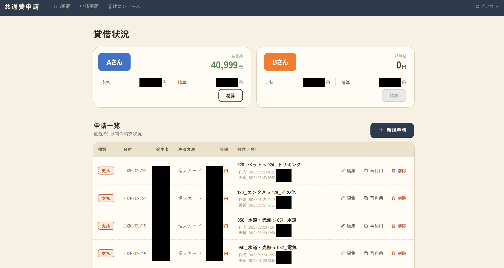
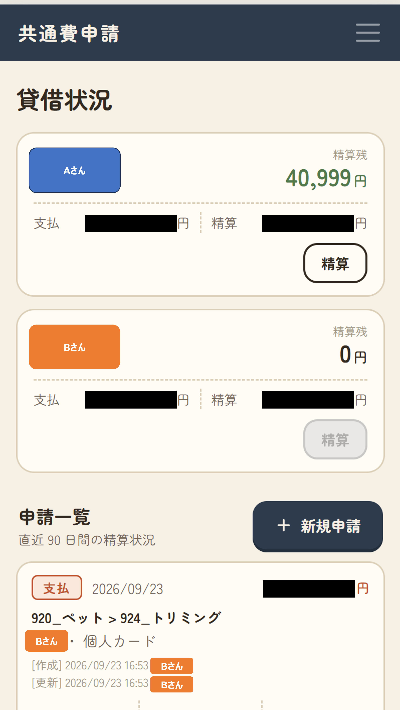
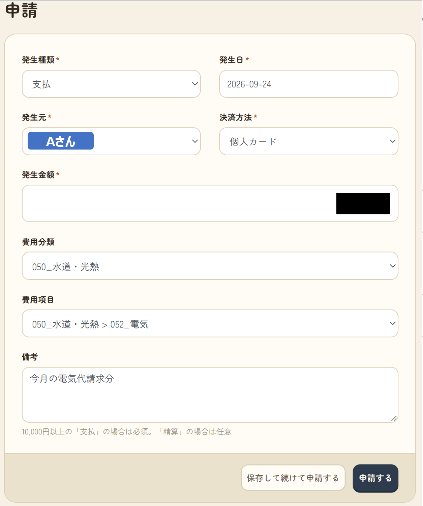
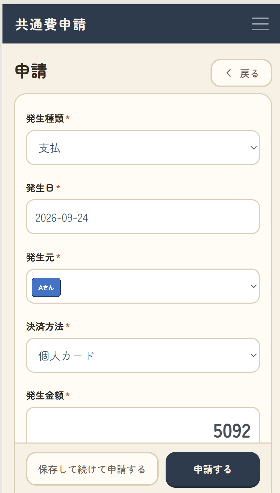
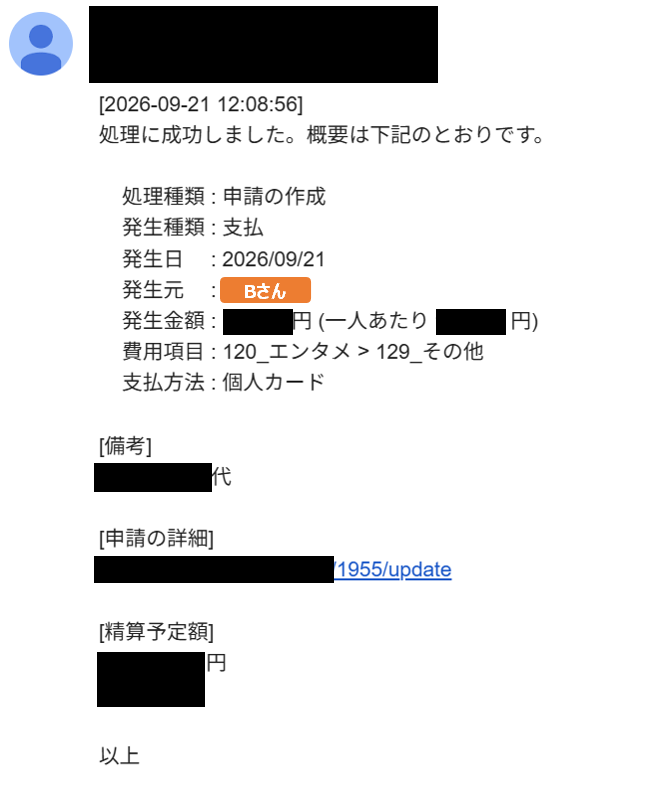
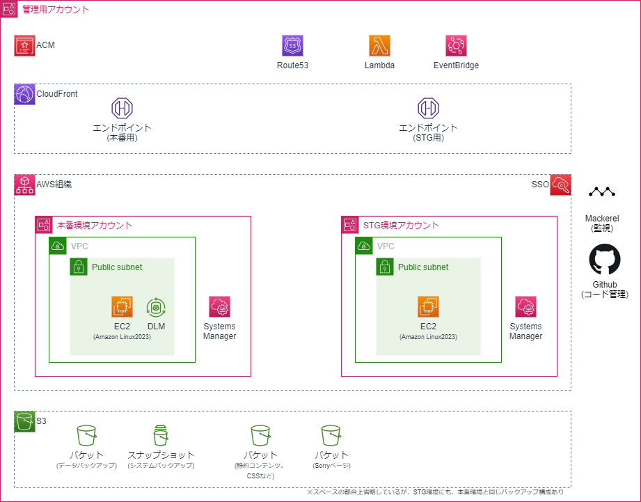
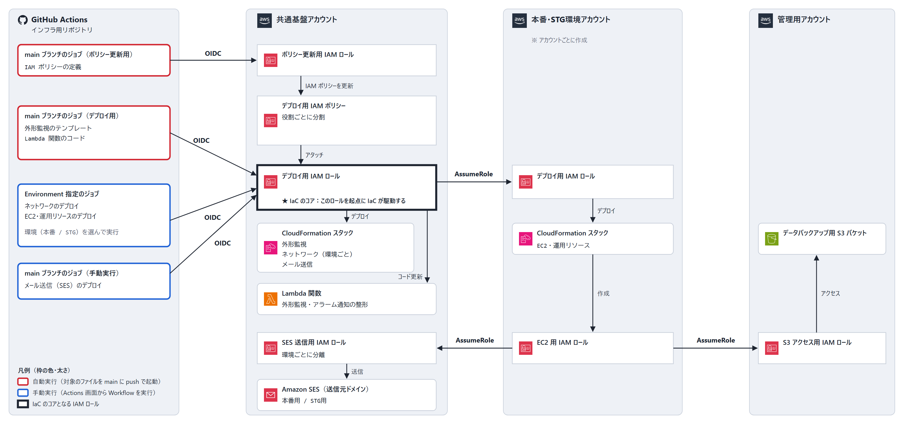

# 共通費申請アプリ — プロジェクト紹介

> [!Note]
> 本資料の土台は [Claude Code](https://claude.ai/code) を使用して作成しています。

---

## 1. プロジェクト概要

### アプリの目的

2人の家族間で共通生活費（食費・光熱費など）を管理・精算するWebアプリケーション。

| 項目 | 内容 |
|---|---|
| 開発体制 | 個人開発（1名） |

### システムの特徴

- **アプリとインフラでリポジトリを分離し、インフラは IaC で管理**: Django アプリ・OS の構築手順はアプリ用リポジトリ、AWS リソースはインフラ用リポジトリで管理。インフラは CloudFormation のテンプレートで定義し、GitHub Actions からデプロイする（[2-5](#2-5-iac-とデプロイ) 参照）
- **マルチアカウント構成とアカウントをまたいだ連携**: 本番・STG をアカウントで分離し、ネットワーク・メール送信・監視などの共通機能は共通基盤アカウントに集約。本番・STG環境アカウントでの EC2 起動をトリガーに管理用アカウントの Lambda が DNS を更新するなど、アカウントをまたいで仕組みが連動する（[2-1](#2-1-マルチアカウント構成) 参照）
- **コストパフォーマンス重視**: Arm ベース（AWS Graviton）のインスタンスを採用し、同等の x86 インスタンスより低コストで運用。Savings Plans の適用、Elastic IP・NAT Gateway の不使用などで、月額 1,000円以下を目標とする

### アプリの主な機能

- 共通費の申請・一覧表示・精算
- 申請時にメール通知
- レスポンシブデザイン（PC・スマートフォン対応）

### 技術スタック（アプリ層）

| カテゴリ | 技術 |
|---|---|
| バックエンド | Python / Django |
| フロントエンド | Bootstrap |
| データベース | SQLite |
| アプリサーバ | uWSGI |
| Webサーバ | Nginx |
| OS | Amazon Linux (EC2) |
| メール送信 | Amazon SES |
| 監視 | Mackerel（無料版）、外形監視（後述） |

### 画面イメージ

#### トップ画面

<p align="center"></p>

<details>
<summary>参考：スマートフォン版</summary>
<p align="center"></p>
</details>

#### 申請画面

<p align="center"></p>

<details>
<summary>参考：スマートフォン版</summary>
<p align="center"></p>
</details>

#### 通知メール

<p align="center"></p>

#### メンテナンス画面

<p align="center"></p>

---

## 2. AWS アーキテクチャ

### 構成図

※ 主要な機能のみを記載。



### 設計コンセプト

> **「とにかく安く、でも本格的に」**
> コスト目標: **1,000円/月以下**

マネージドサービスを最大限活用し、運用負荷を最小化しながらコスト効率を追求した構成。

---

### 2-1. マルチアカウント構成

AWS Organizations とAWS IAM Identity Center（旧AWS SSO）を用いてアカウントを階層管理。開発環境（ローカル）を除き、本アプリに関係するアカウントは「管理用アカウント」「共通基盤アカウント」「本番環境アカウント」「STG環境アカウント」の4つ。

```
管理用アカウント (DNS・配信層)
├── Amazon Route 53
├── Amazon CloudFront (本番用/STG用エンドポイント) + AWS ACM
├── Amazon S3 (データバックアップ・静的ファイル・Sorryコンテンツ)
├── AWS Lambda (Route53 Aレコード自動更新)
└── Savings Plans (購入・割引の共有)

AWS組織 (AWS Organizations + AWS IAM Identity Center)
├── 共通基盤アカウント
│   ├── ネットワーク (VPC・サブネット・セキュリティグループ。AWS RAM で本番/STGへ共有)
│   ├── メール送信 (Amazon SES・送信用 IAM ロール)
│   ├── 外形監視 (Lambda / EventBridge Scheduler / CloudWatch / SNS)
│   └── GitHub Actions 用 OIDC プロバイダ・IAM ロール
│
├── 本番環境アカウント (アプリ層)
│   ├── Amazon EC2 (Djangoアプリ。共有サブネットに配置)
│   ├── Amazon EventBridge Scheduler (定期起動・停止・データバックアップ)
│   ├── Amazon EventBridge (EC2起動検知)
│   ├── Amazon DLM (週次スナップショット) + 成功通知 (CloudWatch Alarm / SNS)
│   └── GitHub Actions 用デプロイ IAM ロール
│
└── STG環境アカウント (アプリ層) ※本番と同じリソースを作成し、一部の状態のみ変更（後述）
```

**マルチアカウントの利点**
- 本番／STGの障害影響を分離
- AWS Organizations + IAM Identity Center による一元的なアカウント・アクセス管理
- ネットワーク・メール送信などの共通機能を共通基盤アカウントに集約し、設定を1か所で管理

**リソース配置の考え方**

| 配置先 | 考え方 | 主なリソース |
|---|---|---|
| 共通基盤アカウント | 環境・システムをまたいで一元管理したいもの。各環境からは VPC 共有や AssumeRole で利用する | VPC、SES、外形監視、GitHub Actions の認証（OIDC） |
| 本番・STG環境アカウント | EC2 と同じアカウントにある必要があるもの（EC2 のイベントは EC2 のあるアカウントに届く、DLM は自アカウントのボリュームのみが対象など）と、同じアカウントに置いた方が権限設計が簡素になるもの | EC2、EventBridge（Scheduler・ルール）、DLM |
| 管理用アカウント | 組織の管理・請求に関わるもののみ。既存の Route 53・CloudFront・S3・Lambda は、AWS の推奨に従い共通基盤アカウントへ移す予定 | Organizations、IAM Identity Center、Savings Plans |

---

### 2-2. 利用 AWS サービス一覧

#### 管理用アカウント

| サービス | 用途 | Well-Architectedの観点 |
|---|---|---|
| **AWS Organizations** | 各アカウントの一元管理 | 運用上の優位性 |
| **AWS IAM Identity Center** | アカウント横断のシングルサインオン・アクセス管理 | セキュリティ・運用上の優位性 |
| **Amazon Route 53** | DNSおよびドメイン管理 | 信頼性 |
| **Amazon CloudFront** | SSLアクセラレータ、静的ファイルキャッシュ、EC2/S3へのルーティング（本番用・STG用エンドポイントを分離） | パフォーマンス効率・セキュリティ |
| **AWS ACM** | SSL/TLS証明書の管理（自動更新） | セキュリティ・運用上の優位性 |
| **Amazon S3** | 静的ファイル・Sorryコンテンツ配信（本番・STGで専用バケットを分離）、データバックアップ保管 | 信頼性・コスト最適化 |
| **AWS Lambda** | EC2起動時のRoute53 Aレコード自動更新（本番・STG環境アカウントのEventBridgeルールから直接呼び出される） | 運用上の優位性・コスト最適化 |
| **Savings Plans** | EC2 の料金割引。管理用アカウントで購入し、本番・STGへ割引を共有 | コスト最適化 |

#### 共通基盤アカウント

| サービス | 用途 | Well-Architectedの観点 |
|---|---|---|
| **Amazon VPC / AWS RAM** | 本番・STG向けの VPC・サブネット・セキュリティグループを作成し、VPC 共有で各アカウントへ提供（[2-3](#2-3-ネットワーク構成) 参照） | セキュリティ・運用上の優位性 |
| **S3 VPCエンドポイント** | EC2からS3へのプライベート通信（Gateway 型） | セキュリティ・コスト最適化 |
| **Amazon SES** | 通知メールの送信（[3-6](#3-6-amazon-ses-によるメール送信の共通化) 参照） | セキュリティ・運用上の優位性 |
| **AWS Lambda / Amazon EventBridge Scheduler / Amazon CloudWatch / Amazon SNS** | 外形監視（[2-6](#2-6-外形監視共通基盤の利用) 参照） | 信頼性・運用上の優位性 |
| **AWS IAM (OIDC プロバイダ)** | GitHub Actions からのデプロイ認証（長期のアクセスキーを使わない） | セキュリティ |
| **AWS CloudFormation** | 共通基盤のリソースを IaC で管理（GitHub Actions からデプロイ） | 運用上の優位性 |

#### 各アカウント（本番・STG）

| サービス | 用途 | Well-Architectedの観点 |
|---|---|---|
| **Amazon EC2** | Djangoアプリのホスティング。Arm ベース（AWS Graviton）の軽量インスタンスを利用し、Savings Plans を適用 | パフォーマンス効率・コスト最適化・サステナビリティ |
| **Amazon EventBridge Scheduler** | EC2の定期起動・停止、データバックアップ | 運用上の優位性・コスト最適化 |
| **Amazon EventBridge** | 本番・STGのEC2起動を検知して、別アカウント（管理用アカウント）のLambdaを直接呼び出す | 運用上の優位性 |
| **AWS Systems Manager** | データバックアップ（Run Command）、Session Manager | 運用上の優位性 |
| **AWS Systems Manager Parameter Store** | 機密情報・設定値のコード外部管理 | セキュリティ・運用上の優位性 |
| **Amazon DLM** | EBSの週次スナップショット自動取得 | 信頼性 |
| **Amazon CloudWatch / Amazon SNS** | DLM のスナップショット取得成功をメールで通知 | 信頼性・運用上の優位性 |
| **AWS CloudFormation** | EC2・運用リソース（スケジュール・DLM など）を IaC で管理 | 運用上の優位性・信頼性 |

---

### 2-3. ネットワーク構成

VPC は各環境のアカウントでは作成せず、共通基盤アカウントで環境ごとに作成し、AWS RAM（VPC 共有）で本番・STGの各アカウントへ共有している。各環境のアカウントは、共有されたサブネットに EC2 を配置するだけの構成。

| 項目 | 内容 |
|---|---|
| VPC | 環境ごとに作成。IPv4 と IPv6 のデュアルスタック（理由は後述） |
| サブネット | 単一 AZ のパブリックサブネット |
| S3 VPCエンドポイント | Gateway 型（追加料金なし）で S3 向けの通信を VPC 内で完結 |
| セキュリティグループ（Web 用） | CloudFront の origin-facing prefix list（IPv6 用）からの HTTP のみ許可 |
| セキュリティグループ（メンテナンス用） | 特定の送信元からのメンテナンス用通信のみ許可 |

**IPv6 を使う理由（デュアルスタックにした理由）**
- CloudFront のオリジン向けマネージドプレフィックスリストは、セキュリティグループのルール数のクォータ上で、1 ルールではなく多数のルール分として重み付きで数えられる。IPv4 用と IPv6 用の両方を許可するとデフォルトのクォータを超えるため、CloudFront → EC2 間の接続を IPv6 に統一し、IPv6 用のプレフィックスリストのみを許可している
- IPv6 アドレスは EC2 の停止・起動では変わらないため、CloudFront のオリジンとして DNS レコードを安定して使える（パブリック IPv4 アドレスは起動のたびに変わる。[3-2](#3-2-lambda-による動的-dns-自動更新) 参照）
- IPv4 は、メンテナンス用の通信、Route53 の A レコードの自動更新、IPv6 に対応していない宛先への外向き通信のために維持している

**採用しなかった構成**
- NAT Gateway・プライベートサブネット・マルチ AZ 構成は、コスト目標（1,000円/月以下）の観点から採用していない

---

### 2-4. CloudFront ⇔ EC2 のリクエストフロー

```
クライアント (PC/スマートフォン)
  → Amazon CloudFront (本番用/STG用エンドポイント、AWS ACM による HTTPS)
    → Amazon EC2: Nginx (IPv6 で接続。CloudFront 経由であることを検証)
      → Amazon EC2: uWSGI / Django
```

**CloudFront**
- キャッシュポリシーで、オリジンへ転送するヘッダー等を必要最小限に絞る
- 動的コンテンツを考慮し、オリジン（EC2）向けのキャッシュは実質無効化
- 本番・STG でエンドポイント（ディストリビューション）とオリジン（EC2）を分離し、環境間の影響を排除

**EC2 (VPC)**
- セキュリティグループで、CloudFront の origin-facing prefix list（IPv6 用）からの通信のみ許可（[2-3](#2-3-ネットワーク構成) 参照）

**EC2 (Nginx)**
- prefix list による制限は特定のディストリビューション専用ではないため、多層防御として CloudFront が付与する Origin Custom Header を Nginx で検証し、CloudFront を経由しないアクセスを遮断（Django に届く前に拒否）

---

### 2-5. IaC とデプロイ

共通基盤アカウント・本番/STG環境アカウントのリソースは、インフラ用リポジトリで CloudFormation のテンプレートを管理し、GitHub Actions からデプロイしている。

**GitHub と AWS 各アカウントの認証連携**



- GitHub Actions は長期のアクセスキーを使わず、OIDC で共通基盤アカウントのデプロイ用 IAM ロール（IaC のコア）を引き受ける
- 本番/STG環境アカウントへは、このロールからさらに AssumeRole する（ロールの連鎖）ことで、GitHub と信頼関係を結ぶアカウントを1つに限定
- アカウントをまたがない IAM ロール（EventBridge Scheduler・DLM など）と、IAM ロールを引き受けない経路（EventBridge から管理用アカウントの Lambda の呼び出し）は省略

**デプロイの仕組み**

IaC による自動化は、誤った変更も一度に反映してしまう。そのため、**自動化に伴う破壊的変更の影響を極小化する**ことを基本の考え方とし、影響の大きい変更ほど人の確認を挟む仕組みにしている。

- デプロイは ChangeSet で差分を表示してから実行し、EC2 の置き換え（データの消失）を含む変更は明示的に許可しない限り停止
- 影響の大きいスタック（ネットワーク・メール送信・EC2・運用リソース）は、push 時は静的検証（cfn-lint）のみ行い、デプロイは環境を選んで手動で実行
- 上記以外（外形監視など）は、自動化しやすいものからできるだけ push での自動デプロイにしている
- EC2 は終了保護を有効にし、スタックの操作を誤っても EC2 が削除されないようにしている。あわせて、IMDSv2 の必須化、EBS の暗号化を Launch Template で設定
- 複雑化を防ぐため、OS 内の構築は手順書ベースで実施（Ansible などの構成管理ツールは使用していない）

---

### 2-6. 外形監視（共通基盤の利用）

本アプリ専用ではなく、複数システムで共有する共通インフラ（インフラ用リポジトリで管理）の仕組みを利用して、外部（インターネット）からの L7 レベルの死活監視を行っている。

| 項目 | 内容 | Well-Architectedの観点 |
|---|---|---|
| 監視方式 | AWS Lambda が対象 URL へ定期的に HTTP リクエストを送信 | 信頼性 |
| スケジューリング | Amazon EventBridge Scheduler | 運用上の優位性 |
| メトリクス | Amazon CloudWatch カスタムメトリクス | 信頼性 |
| アラート通知 | CloudWatch Alarm → Amazon SNS (raw) → AWS Lambda で日本語の本文に整形 → Amazon SNS (通知用) 経由でメール通知 | 運用上の優位性・信頼性 |
| アラームミュート | EC2 の定期停止時間帯に合わせて自動ミュート（CloudWatch Alarm Mute Rule） | コスト最適化・運用上の優位性 |
| IaC・デプロイ | AWS CloudFormation + GitHub Actions（AWS 認証は OIDC） | 運用上の優位性・セキュリティ |

- Alarm Mute Rule は `AlarmActions`/`OKActions` の実行を抑制するため、ミュート期間中は raw 用 SNS への通知自体が発生せず、整形用 Lambda も起動されない

---

## 3. 工夫したポイント（AWS アーキテクチャ）

### 3-1. EC2 定期起動・停止によるコスト削減

サービス提供時間を限定し、深夜帯はEC2を停止。

```
EventBridge Scheduler (ユニバーサルターゲット) → EC2 API (StartInstances / StopInstances)
```

- **ユニバーサルターゲット**: EventBridge Scheduler の機能で、Lambda などを介さずに、多くの AWS サービスの API を直接呼び出せる。呼び出す API（例: EC2 の `StartInstances`）と、その API に渡すパラメータを JSON で指定する。データバックアップも同じ仕組みで SSM の API（Run Command）を直接呼び出している
- 以前は SSM Automation を経由していたが、ユニバーサルターゲットで EC2 の API を直接呼び出す構成に変更し、仕組みを簡素化
- Scheduler の実行ロールは、対象の EC2 の起動・停止とバックアップ用コマンドの実行のみに限定（範囲の広いマネージドポリシーは使わない）
- 失敗時に大きく時間がずれて起動・停止されないよう、再試行の回数・期間を短く制限
- 対象の EC2 はインスタンス ID で指定し、デプロイ時に EC2 のスタックの出力から自動で取得（EC2 を作り直しても再デプロイだけで追従）

**コスト効果**: EC2 稼働時間を削減。パブリック IPv4 アドレス課金も停止中は発生しない。

……のだったのが、途中から割引購入（RI、現在は Savings Plans）に切り替えたため、EC2 の料金面では特に止める必要はなくなった (パブリック IPv4 の課金は減らせるので、全く無駄なわけではない)。本番運用のイメージ & 安定稼働のために、定期停止・定期起動の運用は残している。

**STG の運用**: 本番と同じリソースを作成し、状態だけを変えている。

| リソース | 本番 | STG |
|---|---|---|
| 定期起動 | 有効 | 無効（必要なときに手動で起動） |
| 定期停止 | 有効 | 有効（停止忘れの防止） |
| データバックアップ | 有効 | 無効 |
| Route53 Aレコード自動更新 | 有効 | 有効（手動で起動したときも更新するため） |
| 週次スナップショット（DLM） | 有効 | 無効 |

---

### 3-2. Lambda による動的 DNS 自動更新

EC2 停止中はパブリック IPv4 アドレスが解放されるため、起動時に IP が変わる。
**Elastic IP を使わず**、Lambda + EventBridge で Route53 を自動更新する設計を採用。

```
EC2 起動
  → EventBridge ルール (本番・STG環境アカウント。EC2 State Change 検知)
    → Lambda (管理用アカウント。クロスアカウントターゲットとして直接呼び出し)
      → STS AssumeRole で本番・STG環境アカウントの EC2 情報を取得
        → Route53 Aレコード UPSERT
```

- 本番・STG環境アカウントの EventBridge ルールから、管理用アカウントの Lambda を直接呼び出す（管理用アカウントのイベントバスは経由しない）
  - 以前は、別アカウントの Lambda を呼び出すには、Lambda のあるアカウントのイベントバスにイベントを転送し、そのアカウントのルールから呼び出す必要があった
  - 2025年1月の EventBridge のアップデートで、別アカウントの Lambda・SQS・SNS などをルールのターゲットとして直接指定できるようになったため、中継のイベントバスとルールを不要にした
- 呼び出し側は EventBridge の実行ロール、呼び出される側は Lambda のリソースベースポリシーで許可する
- EventBridge ルールはインスタンス ID で絞らず、Lambda 側で対象のタグを持つ EC2 のみを処理するため、EC2 を作り直してもルールの変更は不要
- AAAA レコード（CloudFront のオリジンとして使用）は、IPv6 アドレスが停止・起動で変わらないため、EC2 の作成・再作成時のみ更新

**Elastic IP 不使用の理由**
- Elastic IP は停止中も課金が発生する（2024年以降はパブリック IPv4 アドレスが稼働中も課金対象のため、稼働中の料金は変わらない）
- Lambda + Route53 による動的更新で、停止中の IP アドレスの課金を回避

**EC2 タグ連携**: EC2 のタグに FQDN を設定するだけで、Lambda が自動的に対象ホスト名を解決する柔軟な設計。タグは Launch Template で付与し、起動時点で確実に付いているようにしている。

---

### 3-3. クロスアカウントアクセス（STS AssumeRole）

S3 バックアップ・Route53 更新・メール送信いずれも、アカウント間のリソースアクセスに **STS AssumeRole** を活用。

```
本番/STG環境アカウント (EC2 インスタンスロール)
  ├── sts:AssumeRole → 管理用アカウント (S3: データバックアップ・静的ファイルのアップロード)
  └── sts:AssumeRole → 共通基盤アカウント (SES 送信用ロール。環境ごとに分離)

管理用アカウント (Lambda 実行ロール)
  → sts:AssumeRole
    → 本番/STG環境アカウント (EC2 情報の参照のみ。結果をもとに Route53 を更新)
```

- 最小権限の原則に従い、必要なアクションのみを許可するポリシーを設計

---

### 3-4. 多層バックアップ戦略

| バックアップ種別 | 手段 | 頻度 | 保管先 |
|---|---|---|---|
| **データバックアップ** (SQLiteファイル) | EventBridge Scheduler → SSM Run Command → S3 cp | 毎日深夜 | Amazon S3（管理用アカウント） |
| **システムバックアップ** (EBSスナップショット) | Amazon DLM | 毎週深夜 | EBSスナップショット（各アカウント） |

- データ（SQLite）は軽量なためS3への日次コピーが容易
- S3 のバージョニングとライフサイクルルールで保存期間を管理
- EBSスナップショットにより、OSレベルの障害にも対応
- DLM のスナップショット取得成功を CloudWatch Alarm（DLM のメトリクスを監視）→ SNS でメール通知し、バックアップの成否を日常的に確認
- **リストアはデプロイの仕組みを再利用**: スナップショットから作成した AMI を、通常の EC2 デプロイと同じワークフローに指定するだけで EC2 を作り直せる設計。ChangeSet による差分確認、EC2 の置き換えの明示的な許可、運用リソース（スケジュール・DLM）の新しい EC2 への追従など、デプロイ時の仕組みをそのまま使えるため、リストア専用の仕組みを持たない
- リストア手順は Runbook 化し、リハーサルで手順を検証済み
- **リストアのイメージ**: システムバックアップ（EBS スナップショット）で EC2 を取得時点の状態にロールバックし、データバックアップ（S3 の SQLite ファイル）で直近のデータまでロールフォワードする
- RPO（目標復旧時点）: データ最大24時間 / システム最大7日間

---

### 3-5. CloudFront による統合エントリーポイント

```
クライアント
  → Amazon CloudFront (+ AWS ACM による HTTPS)
    ├── /static/* → Amazon S3 (静的ファイル)
    └── /* → Amazon EC2 (Djangoアプリ)
               └── 500 応答時 → Amazon S3 (Sorry ページ)
```

- **SSL/TLS**: ACM 証明書を CloudFront にアタッチ（証明書の自動更新）。比較的高価な ALB を使わずに、ACM の証明書（CloudFront との組み合わせで無料）を利用できる
- **オリジンの抽象化**: EC2 の IP が変わっても、ユーザーは CloudFront のドメインのみ意識すれば良い
- **静的ファイルのキャッシュ**: 静的ファイルは S3 から CloudFront でキャッシュ配信し、EC2 の負荷を低減。更新時は invalidation で反映する
- **S3 アクセス制御**: OAC を使い、バケットポリシーで対応する環境の CloudFront のみ許可。パブリックアクセスブロックは有効
- **環境分離**: 本番・STG で専用の S3 バケットを持ち、一方へのアップロードがもう一方の配信に影響しない
- **フェイルオーバー**: EC2 停止中（メンテナンス時間帯）はオリジンから 500 応答が返るため、S3 の Sorry ページに切り替えて表示

---

### 3-6. Amazon SES によるメール送信の共通化

通知メールの送信基盤を Amazon SES に移行。SES は共通基盤アカウントに置き、本番/STGの EC2 は送信用 IAM ロールを AssumeRole して送信する。

```
本番/STG環境アカウント (EC2: Django)
  → sts:AssumeRole (環境ごとの送信用ロール)
    → 共通基盤アカウント (Amazon SES)
      → 宛先 (検証済みのメールアドレスのみ)
```

| 項目 | 内容 | Well-Architectedの観点 |
|---|---|---|
| 送信用ロールの信頼ポリシー | 各環境のアカウントを Principal とし、条件（`aws:PrincipalArn`）でその環境の EC2 インスタンスロールのみに限定。ロールを作り直しても信頼関係が切れない | セキュリティ・信頼性 |
| 送信元の制限 | 条件（`ses:FromAddress`）で、送信元をその環境のドメインのみに限定（STG から本番のドメインで送信できない） | セキュリティ |
| 送信ドメインの認証 | Easy DKIM と DMARC を設定。DNS レコードは Route 53 の Record Protection で誤変更・誤削除を防止 | セキュリティ・信頼性 |
| 送信失敗時の動作 | 申請の処理は完了させ、画面に警告を表示（申請の二重登録を防止） | 信頼性 |
| 送信数の把握 | SES の sandbox では、24 時間あたりの送信数に上限がある。通知メールに直近24時間の送信数を参考値として表示し、上限への接近を把握 | 運用上の優位性 |

- SES の sandbox・クォータはアカウント単位で適用されるため、各環境のアカウントで SES を使うと宛先の検証などを環境ごとにやり直す必要がある。各環境のアカウントの SES から委任送信者として送る方式（Sending authorization）も同じ理由で不採用
- SES のリソース（ID・DKIM・宛先の検証）は作り直しの影響が大きいため、EC2 の運用リソースとは別の IaC スタックで管理

---

## 4. AWS Well-Architected フレームワークの観点

| 柱 | 取り組み |
|---|---|
| **運用上の優位性** | EventBridge Scheduler による EC2 の自動起動・停止・データバックアップ、Lambda による DNS 自動更新、DLM によるスナップショット自動取得と成功通知、CloudFormation + GitHub Actions による IaC（ChangeSet による差分確認）、Parameter Store による設定値の一元管理、IAM Identity Center によるアクセス管理の一元化、共通機能（ネットワーク・メール送信・外形監視）の共通基盤アカウントへの集約 |
| **セキュリティ** | CloudFront + ACM による HTTPS 強制、セキュリティグループ（CloudFront origin-facing prefix list）と Origin Custom Header の検証による CloudFront 経由以外のアクセス遮断、OAC による S3 へのアクセス制御、S3 VPC エンドポイントによるプライベート通信、STS AssumeRole による最小権限のクロスアカウントアクセス、IMDSv2 の必須化・EBS の暗号化、SES の送信元・送信者の条件による制限、Parameter Store による機密情報のコード外部管理、ログイン試行回数の制限、GitHub Actions の OIDC 認証（長期のアクセスキー不使用）とロールの連鎖、CLI アクセスの送信元 IP 制限 |
| **信頼性** | マルチアカウント構成による環境分離、多層バックアップ（S3 日次 + DLM 週次）とスナップショットの取得成功通知、Runbook 化・リハーサル済みのリストア手順、IaC による再構築の容易化、EC2 の終了保護、CloudFront による高可用な配信、外形監視（Lambda + CloudWatch + SNS）による異常検知 |
| **パフォーマンス効率** | CloudFront による静的ファイルキャッシュ、サービス要件に合わせた EC2 インスタンスタイプ選定（インスタンスを作り直さずに変更できる IaC 設計） |
| **コスト最適化** | Savings Plans の適用、Elastic IP 不使用（Lambda + Route53 で代替）、NAT Gateway 不使用・単一 AZ 構成、S3 + CloudFront による静的配信でEC2負荷低減、マネージドサービス活用による運用コスト削減、外形監視アラームの定期停止時間帯自動ミュート、STG は必要時のみ起動 |
| **サステナビリティ** | EC2 夜間停止・STG の必要時のみの起動によるコンピューティングリソースの節約、エネルギー効率の高い Arm ベース（AWS Graviton）インスタンスの利用 |

---

## 5. コスト構造（目標: 1,000円/月以下）

為替によりけりだが、おそらく 1,000円/月は切っていると思う。

| サービス | 備考 |
|---|---|
| Amazon EC2 | 軽量インスタンスタイプの利用、Savings Plans（EC2 Instance Savings Plans）の適用。STG は必要時のみ起動するため専用の Savings Plans は購入しない |
| Amazon VPC | パブリック IPv4 の利用料 |
| Amazon S3 | データ容量が小さいため数円以下 |
| Amazon CloudFront | 無料利用枠内を想定 |
| Amazon Route 53 | ホストゾーン料金のみ |
| AWS Lambda | 無料利用枠内を想定 |
| Amazon SES | 送信数が少ないため少額 |
| AWS ACM | 無料（CloudFront との組み合わせ） |
| Amazon DLM | スナップショットストレージ費のみ |
| AWS Systems Manager Parameter Store | Standard パラメータは無料 |
| AWS IAM Identity Center | 無料 |

---

## 6. 出典

- 本資料は、アプリ用リポジトリ（非公開）とインフラ用リポジトリ（非公開）のドキュメント・テンプレートをもとに作成
- AWS の仕様に関する記述の一部（SES の sandbox の送信上限、CloudFront のマネージドプレフィックスリストの重み、EC2 の IPv6 アドレスの保持、DLM のポリシーの対象範囲、EventBridge のクロスアカウントターゲット、EventBridge Scheduler のユニバーサルターゲット）は、aws-knowledge MCP サーバー経由で AWS 公式ドキュメント・発表を参照して確認
  - [Amazon EventBridge announces direct delivery to cross-account targets（2025年1月）](https://aws.amazon.com/about-aws/whats-new/2025/01/amazon-eventbridge-direct-delivery-cross-account-targets/)
  - [EventBridge Scheduler でのユニバーサルターゲットの使用](https://docs.aws.amazon.com/ja_jp/scheduler/latest/UserGuide/managing-targets-universal.html)
  - [Service quotas in Amazon SES](https://docs.aws.amazon.com/ja_jp/ses/latest/dg/quotas.html)
  - [AWS マネージドプレフィックスリスト](https://docs.aws.amazon.com/ja_jp/vpc/latest/userguide/working-with-aws-managed-prefix-lists.html)
  - [Amazon EC2 インスタンスの IP アドレス](https://docs.aws.amazon.com/ja_jp/AWSEC2/latest/UserGuide/using-instance-addressing.html)

---

以上
